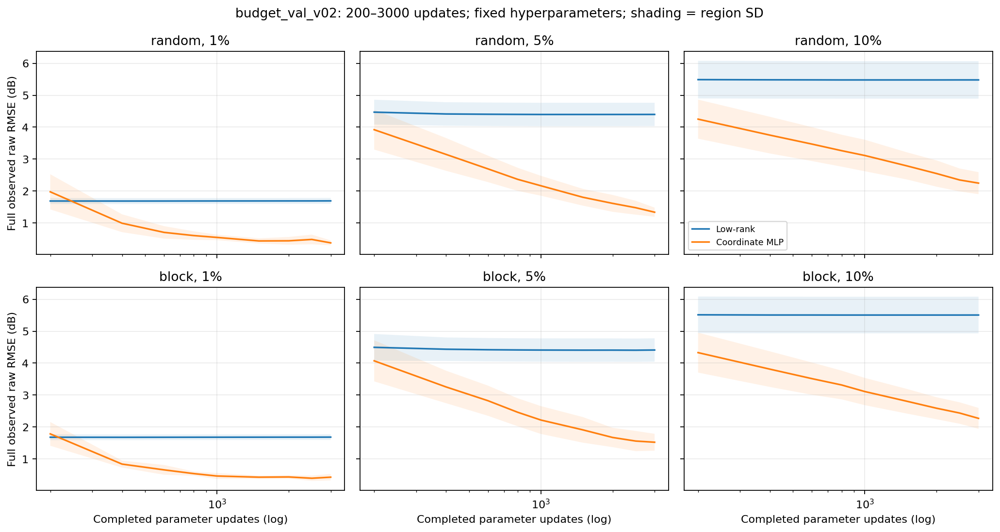
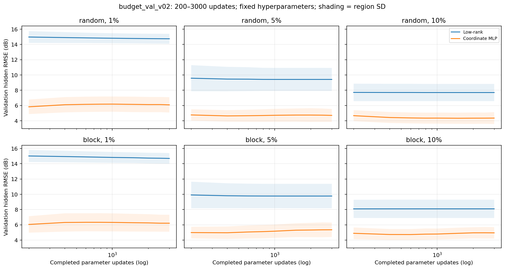
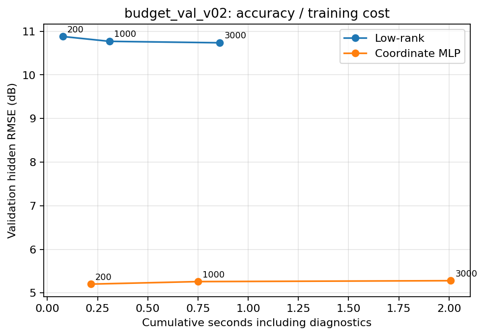
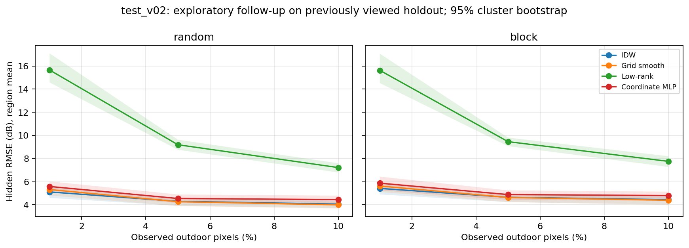
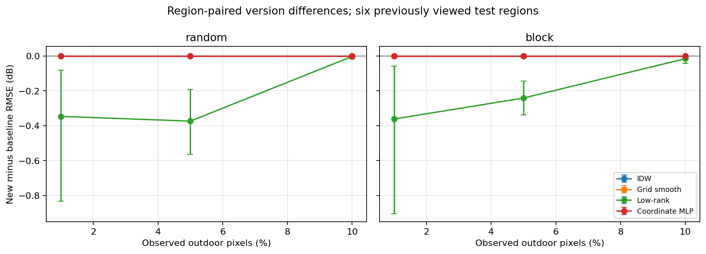
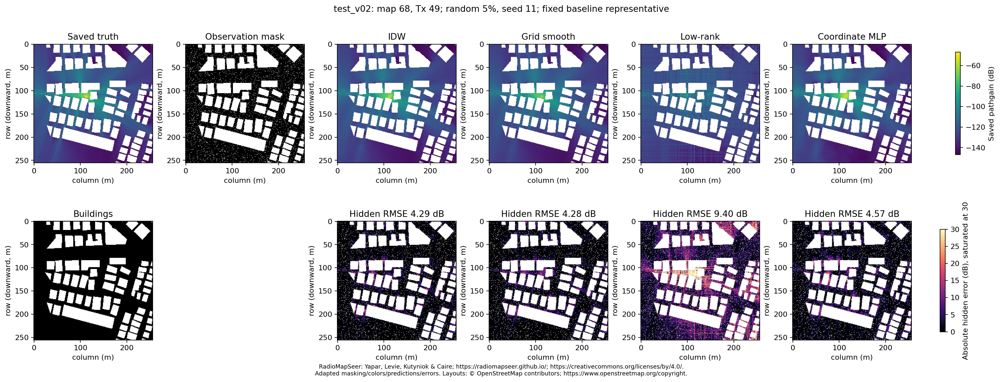

# SparseRadioMap v0.1.0: Corrections and Training-Budget Diagnostics

Author: Yuntao Xue. Experimental versions: baseline_v01 → test_v02. This comparison is a **follow-up exploratory evaluation on the same previously viewed holdout**, not a new confirmatory test.

## 1. Preserved baseline and implementation fixes

The original experiment used 30 regions and 60 no-car DPM images, with an 18/6/6 development/validation/test region split. Its 16 pipeline checks, 216 tuning runs, 864 main reconstructions and 200-step neural training budget are preserved. Original result directories were not overwritten. The complete local `history/baseline_v01/snapshot.zip` preserves source, configurations, records, masks, predictions, reports and figures; `snapshot_manifest.json` records per-file SHA-256 hashes. The original ZIP was reused without downloading it again, and its SHA-256 was verified as `c80672cea3b3693d4a0a57eefb36a1a7e3ef78e04a99e6842d5a96afb6cc072f`.

The first-run fix explicitly creates `configs`, `reports` and `data/processed` before audit outputs are written, and removes a stale completion marker when an audit starts. The regression test calls `audit()` in a temporary directory with a small, valid 256×256 grayscale ZIP, no network access and no pre-existing processed directory. Environment-recording and download directories are also explicitly created.

The legacy unversioned runner is disabled to prevent new source-dependent run IDs from being mixed with old records. Expected-task manifests bind source, parameters, configuration, data and masks. Exports reject extra or missing records, source changes, identity mismatches and file-hash mismatches. Verified cache reuse and new fits have separate counters. A successful cache-only invocation is not evidence of independent reproduction.

## 2. Data, valid pixels and physical encoding

RadioMapSeer contains propagation simulations based on urban layouts, not field measurements. This project uses only DPM without cars at the native 256×256 resolution and 1 m/pixel. Outdoor valid pixels satisfy `building PNG == 0`; outdoor zero-gray pixels remain valid. The normalized target is `y=gray/255`, and saved negative pathgain is `-147+100*y` dB. Zero values are truncated and quantized, so pre-truncation truth cannot be recovered. The author's additional `thresh=0.2` transformation is not applied.

JSON `(x,y)` maps to PNG `(row=255-y, col=x)`. The complete original audit is retained in the local `reports/data_audit.md`. The new version independently regenerates processed arrays from the original ZIP without modifying raw data. The external filesystem does not enforce Unix read-only permissions: read-only use is a workflow rule backed by hash verification, not a claim that the volume is mounted read-only.

## 3. Prespecified budget experiment

Only development and validation data were used for selection; test rankings did not select hyperparameters. Development used the first two development regions in the original manifest, both Tx images per region, both mechanisms, all three fractions and seed 11: 48 training trajectories with 144 checkpoints. After estimating cost, validation used all six validation regions and 12 images, random sampling and 64×64 contiguous holes, observation fractions of 1%, 5% and 10%, and seeds 11/22/33. The two trainable methods produced 432 trajectories and 1,296 checkpoints.

Architecture, initialization, Fourier frequencies, rank, learning rate, regularization and random minibatch sequence were held fixed. Each trajectory saved predictions at 200, 1,000 and 3,000 updates. Prespecified logging steps were 0, 1, 10, 25, 50, 100, 200, 400, 600, 800, 1,000, 1,500, 2,000, 2,500 and 3,000. Each log records complete-observation MAE/RMSE before and after the common prediction clipping policy, data MSE, regularization, total objective, learning rate, elapsed and optimization time, raw prediction range and clipping fraction.

MLP minibatch loss is explicitly measured **before** the update; complete-observation diagnostics are measured **after** the update. Hidden truth is accessed only by an external scoring callback using detached NumPy predictions; callback results do not affect optimization. Legacy ordinary-reconstruction final-loss metadata comes from before the final update and is distinguished from post-update complete-observation diagnostics.

The low-rank objective is `MSE + reg*(mean(U²)+mean(V²))`. A fixed observed mean occupies one rank component; the remaining components represent the residual. MLP uses Adam with coupled L2 weight decay; its logged complete objective is `MSE + (reg/2)*sum(parameter²)`. A minibatch loss is not presented as that complete objective. Diagnostic timings include logging and scoring forward passes, while main reconstruction timings exclude scoring and file I/O; these timings are not interchangeable.

On real development images, the 200-step trajectory predictions exactly matched the original low-rank and MLP implementations, with maximum difference zero. Complete validation logs: [training_curves.csv](../results/budget_val_v02/training_curves.csv).

## 4. Observed budget results and configuration selection

The following values first average Tx, seeds, mechanisms and fractions equally within each region, then average across the six validation regions. Observed RMSE uses clipped predictions. Complete raw observation errors and objective decompositions remain available in the curve CSV.

| method | checkpoint_step | observed_rmse_db | hidden_rmse_db | data_fit_mse | regularization | total_objective | seconds |
| --- | --- | --- | --- | --- | --- | --- | --- |
| lowrank | 200 | 3.8883 | 10.8802 | 0.0018 | 0.0044 | 0.0062 | 0.0779 |
| lowrank | 1000 | 3.8594 | 10.7698 | 0.0018 | 0.0044 | 0.0061 | 0.3101 |
| lowrank | 3000 | 3.8611 | 10.7368 | 0.0018 | 0.0044 | 0.0061 | 0.8586 |
| mlp | 200 | 3.3879 | 5.2020 | 0.0013 | 0.0003 | 0.0017 | 0.2156 |
| mlp | 1000 | 1.9344 | 5.2595 | 0.0005 | 0.0003 | 0.0008 | 0.7498 |
| mlp | 3000 | 1.3583 | 5.2802 | 0.0003 | 0.0003 | 0.0005 | 2.0087 |







Selection minimizes region-averaged hidden RMSE, balancing both mechanisms and all three fractions; ties prefer fewer steps. Settings were not selected separately for each test image. The frozen configuration is:

```json
{
  "idw": {
    "k": 16,
    "power": 2.0
  },
  "lowrank": {
    "lr": 0.03,
    "rank": 4,
    "reg": 0.05,
    "steps": 3000
  },
  "mlp": {
    "bands": 3,
    "batch_size": 1024,
    "lr": 0.003,
    "reg": 1e-05,
    "steps": 200,
    "width": 64
  },
  "smooth": {
    "lam": 0.05,
    "maxiter": 2500,
    "rtol": 1e-05
  }
}
```

Freeze time: `2026-10-13T06:15:19.527113+00:00`. Scientific source SHA-256: `e4c8399c0dd9e91230f7b6c2bb7ec891e73237a05034bdf9c7943846d85c6bef`. Full candidates, validation-plan hash, configuration provenance and selection rationale are recorded in [selected_v02.json](../configs/selected_v02.json).

The prespecified additional-tuning gate requires complete-observation raw low-rank RMSE to be at least 0.04 in normalized units at every budget. Gate triggered: **False**. Recorded values: `{'200': 0.038884675158539675, '1000': 0.03859552105304435, '3000': 0.03861273639104506}`. If triggered, only `reg=0.01` and `0.1` would be compared at the budget-selected step count, keeping rank, learning rate and architecture fixed and using the same complete validation conditions. The search was not expanded. Additional validation checkpoints: **0**. The complete candidate table follows; candidates with different regularization must not be treated as checkpoints on one trajectory. The table rounds values to four decimals; exact regularization values are preserved in the configuration JSON and candidate CSV.

| method | checkpoint_step | rmse_db | reg |
| --- | --- | --- | --- |
| lowrank | 1000 | 10.7698 | 0.0500 |
| lowrank | 200 | 10.8802 | 0.0500 |
| lowrank | 3000 | 10.7368 | 0.0500 |
| mlp | 1000 | 5.2595 | 0.0000 |
| mlp | 200 | 5.2020 | 0.0000 |
| mlp | 3000 | 5.2802 | 0.0000 |

**Observations:** The tables and condition-specific curves show how complete observed and hidden errors change with budget. MLP observation fitting improves with more updates, but its aggregate validation hidden error increases. Low-rank hidden error improves slightly while observation error plateaus.

**Interpretation:** Falling observation error with rising hidden error suggests overfitting or extrapolation problems under the evaluated model and missingness mechanisms; it does not justify automatically choosing the longest budget. Improvements in both errors would support an insufficient original budget. A low-rank plateau may reflect regularization, optimization or rank limitations, but does not establish inadequate representation capacity. The low-rank regularization term is approximately 0.00438 and data term approximately 0.00176, consistent with a regularization tradeoff.

**Unverified hypotheses:** No rank/architecture ablation, learning-rate search or new model was executed, so those possible explanations are not reported as findings. The gate is a budget-management rule, not a physical-reliability or statistical-significance threshold. A false gate does not establish optimal regularization, and the causal role of regularization was not tested by ablation.

## 5. Holdout results after configuration freeze

The complete `test_v02` comparison contains 12 images × 3 fractions × 2 mechanisms × 3 seeds × 4 methods = **864 new fits**. No previous fitted outputs were reused. Low-rank hidden RMSE averaged equally across six conditions decreased from 11.044 to 10.820 dB, approximately 0.224 dB, without changing the aggregate method ranking under the evaluated budget. Paired improvements at 1%/5% are approximately 0.24–0.37 dB; at 10% they are only approximately 0.004–0.016 dB. Their practical magnitude should not be overstated.

MLP, IDW and smoothing configurations were unchanged, and their new predictions matched the baseline. Historical results were used only for subsequent paired comparisons and independent checks. Training does not read hidden truth. Raw predictions and shared masks are retained locally in separate version directories. Parameters were frozen before viewing this new holdout comparison, but the original holdout had already been viewed, so this remains a follow-up exploratory evaluation.

| version | fraction | mechanism | method | mae_db | rmse_db | bias_db | observed_rmse_db | hole_rmse_db | gradient_rmse_db | seconds |
| --- | --- | --- | --- | --- | --- | --- | --- | --- | --- | --- |
| test_v02 | 0.0100 | block | idw | 2.5573 | 5.4208 | 0.1011 | 0.0000 | 9.4072 | 5.9143 | 0.0749 |
| test_v02 | 0.0100 | block | lowrank | 12.1103 | 15.6277 | -0.4382 | 1.5920 | 16.1538 | 17.7983 | 0.5451 |
| test_v02 | 0.0100 | block | mlp | 3.0490 | 5.8725 | -0.0124 | 1.9154 | 9.8764 | 6.1737 | 0.1061 |
| test_v02 | 0.0100 | block | smooth | 3.0304 | 5.6290 | -0.1230 | 0.3646 | 9.2858 | 6.2218 | 0.0842 |
| test_v02 | 0.0100 | random | idw | 2.3316 | 5.1154 | 0.2532 | 0.0000 | nan | 5.4312 | 0.0774 |
| test_v02 | 0.0100 | random | lowrank | 12.1431 | 15.6543 | -0.0123 | 1.5998 | nan | 17.8512 | 0.5712 |
| test_v02 | 0.0100 | random | mlp | 2.8651 | 5.5879 | 0.1095 | 1.8537 | nan | 5.9139 | 0.1047 |
| test_v02 | 0.0100 | random | smooth | 2.8284 | 5.3228 | 0.0629 | 0.3628 | nan | 5.6011 | 0.0733 |
| test_v02 | 0.0500 | block | idw | 1.6670 | 4.6558 | 0.1309 | 0.0000 | 8.4546 | 5.1164 | 0.0960 |
| test_v02 | 0.0500 | block | lowrank | 6.5352 | 9.4617 | -0.1148 | 4.0232 | 13.3037 | 11.0328 | 0.7246 |
| test_v02 | 0.0500 | block | mlp | 2.4202 | 4.8894 | -0.0598 | 3.7400 | 8.5545 | 4.7843 | 0.1428 |
| test_v02 | 0.0500 | block | smooth | 1.8454 | 4.6372 | -0.0607 | 0.3635 | 8.2176 | 4.8757 | 0.0644 |
| test_v02 | 0.0500 | random | idw | 1.4299 | 4.3042 | 0.1878 | 0.0000 | nan | 4.4598 | 0.0964 |
| test_v02 | 0.0500 | random | lowrank | 6.3997 | 9.1962 | 0.3108 | 4.0962 | nan | 10.4921 | 0.7274 |
| test_v02 | 0.0500 | random | mlp | 2.2155 | 4.5501 | 0.0661 | 3.8342 | nan | 4.1006 | 0.1458 |
| test_v02 | 0.0500 | random | smooth | 1.6049 | 4.2733 | 0.0361 | 0.3720 | nan | 4.0817 | 0.0515 |
| test_v02 | 0.1000 | block | idw | 1.4646 | 4.4495 | 0.1035 | 0.0000 | 8.3378 | 4.9377 | 0.1082 |
| test_v02 | 0.1000 | block | lowrank | 5.1896 | 7.7582 | -0.0775 | 4.9598 | 12.3986 | 8.8325 | 0.9803 |
| test_v02 | 0.1000 | block | mlp | 2.3824 | 4.8029 | -0.0053 | 4.0521 | 8.2909 | 4.5804 | 0.1500 |
| test_v02 | 0.1000 | block | smooth | 1.5694 | 4.3985 | -0.0888 | 0.3788 | 8.0747 | 4.7871 | 0.0591 |
| test_v02 | 0.1000 | random | idw | 1.2050 | 4.0637 | 0.1676 | 0.0000 | nan | 4.2320 | 0.1081 |
| test_v02 | 0.1000 | random | lowrank | 4.8996 | 7.2229 | 0.3216 | 5.0405 | nan | 7.9787 | 1.0016 |
| test_v02 | 0.1000 | random | mlp | 2.1538 | 4.4529 | 0.0150 | 4.0822 | nan | 3.8402 | 0.1474 |
| test_v02 | 0.1000 | random | smooth | 1.2953 | 4.0002 | 0.0397 | 0.3820 | nan | 3.9670 | 0.0478 |





Paired differences are new minus baseline; negative values favor the new version:

| fraction | mechanism | method | n_regions | delta_new_minus_baseline_db | ci_low_db | ci_high_db |
| --- | --- | --- | --- | --- | --- | --- |
| 0.0100 | random | idw | 6 | 0.0000 | 0.0000 | 0.0000 |
| 0.0100 | random | smooth | 6 | 0.0000 | 0.0000 | 0.0000 |
| 0.0100 | random | lowrank | 6 | -0.3467 | -0.8328 | -0.0813 |
| 0.0100 | random | mlp | 6 | 0.0000 | 0.0000 | 0.0000 |
| 0.0100 | block | idw | 6 | 0.0000 | 0.0000 | 0.0000 |
| 0.0100 | block | smooth | 6 | 0.0000 | 0.0000 | 0.0000 |
| 0.0100 | block | lowrank | 6 | -0.3617 | -0.9042 | -0.0592 |
| 0.0100 | block | mlp | 6 | 0.0000 | 0.0000 | 0.0000 |
| 0.0500 | random | idw | 6 | 0.0000 | 0.0000 | 0.0000 |
| 0.0500 | random | smooth | 6 | 0.0000 | 0.0000 | 0.0000 |
| 0.0500 | random | lowrank | 6 | -0.3740 | -0.5642 | -0.1929 |
| 0.0500 | random | mlp | 6 | 0.0000 | 0.0000 | 0.0000 |
| 0.0500 | block | idw | 6 | 0.0000 | 0.0000 | 0.0000 |
| 0.0500 | block | smooth | 6 | 0.0000 | 0.0000 | 0.0000 |
| 0.0500 | block | lowrank | 6 | -0.2417 | -0.3373 | -0.1441 |
| 0.0500 | block | mlp | 6 | 0.0000 | 0.0000 | 0.0000 |
| 0.1000 | random | idw | 6 | 0.0000 | 0.0000 | 0.0000 |
| 0.1000 | random | smooth | 6 | 0.0000 | 0.0000 | 0.0000 |
| 0.1000 | random | lowrank | 6 | -0.0035 | -0.0165 | 0.0082 |
| 0.1000 | random | mlp | 6 | 0.0000 | 0.0000 | 0.0000 |
| 0.1000 | block | idw | 6 | 0.0000 | 0.0000 | 0.0000 |
| 0.1000 | block | smooth | 6 | 0.0000 | 0.0000 | 0.0000 |
| 0.1000 | block | lowrank | 6 | -0.0159 | -0.0430 | 0.0008 |
| 0.1000 | block | mlp | 6 | 0.0000 | 0.0000 | 0.0000 |

Validation subconditions show that MLP hidden RMSE under random 10% observations decreases from 4.675 to 4.358 dB, while under contiguous-hole 5% observations it increases from 4.988 to 5.354 dB; 1% conditions also worsen. Choosing 200 steps reflects the balanced aggregate criterion, not a claim that every condition favors shorter training.

Regions are the aggregation and bootstrap units. The 2,000 bootstrap resamples draw entire regions while retaining their Tx/seed structure. Intervals based on six holdout regions are exploratory; pixels are not sampled as independent observations. New-version smoothing minus IDW RMSE ranges from -0.0634 to 0.2082 dB, averaging 0.0419 dB. These small effect sizes must be reported; an exploratory interval excluding zero alone does not establish a substantial practical advantage. High-gradient scoring retains the prespecified top 10% of outdoor finite-difference gradients. Hidden, observed and hole-interior locations are scored separately. CSVs also record unclipped RMSE and clipping fractions.



The spatial example retains the baseline's prespecified median representative, without selecting an attractive image from new results. Signal color limits are shared at −147 to −47 dB; error limits are 0 to 30 dB. Attribution and modifications are documented in [FIGURE_ATTRIBUTION.md](FIGURE_ATTRIBUTION.md).

## 6. Genuine first runs, independent reproduction and consistency

Fresh-run commands require an empty output directory and read only the hash-verified original ZIP to process a real image, generate masks, fit all four methods, score and export. Existing processed arrays, records and predictions are not fitting inputs. Reference records are accessed only after new fitting finishes. Actual records are preserved in `experiments/fresh_dev_v02/reports/fresh_verification.json` and `experiments/fresh_test_v02/reports/fresh_verification.json`. The development example reproduces the baseline 200-step configuration; the holdout example reproduces the final frozen configuration. Each executed four real fits with zero cache hits.

The minimal public staging source passed all 15 tests and executed four fresh fits in another empty directory. Its package contains no reference arrays; after fitting, outputs were separately compared against the complete local baseline. Masks, predictions and metrics matched exactly, as recorded in [public_candidate_fresh_verification.json](public_candidate_fresh_verification.json). An explicit `--cpu` fresh check also executed four fits and matched its baseline exactly. The revision executed **1,364 fitting calls**, excluding unit tests. Its 1,440 diagnostic checkpoints share 480 trajectories and are not independent fitting calls.

Using the complete local truth and raw outputs, all 864 baseline and all 864 new-version main metric records were recomputed independently and compared against CSV and JSON. Checks also covered 216 shared masks, equal observation counts and selected parameters. Evidence is in [score_verification.json](score_verification.json) and the `*_recomputed.csv` files. Figures and report tables derive from the version-specific summaries; `presentation_manifest.json` records input CSV and figure hashes.

`requirements-lock.txt` is a **pinned direct-dependency list**, not a complete transitive or wheel-hash lock. A clean Python 3.12 environment without system-site-packages was created, installed from the pins and used for tests and real fresh runs. Resolved versions are recorded in `clean_environment.json`. The local experimental environment is distinguished from user installation instructions; no `.venv` is supplied. **Only CPU was actually tested; cross-device determinism is unverified.**

## 7. Data licensing, packaging and citation

The earlier statement that no clear data license had been found missed a link in the official website HTML and is superseded. Next to the original download, `rel=license` points to [CC BY 4.0](https://creativecommons.org/licenses/by/4.0/), verifiable at line 36 of the [official source](https://raw.githubusercontent.com/radiomapseer/radiomapseer.github.io/master/index.html). Official HTML, repository source, author instructions and hashes are retained locally. Data licensing is not inferred from the paper license or RadioUNet's MIT code license. See [DATA_LICENSE.md](DATA_LICENSE.md).

The original ZIP is reused read-only locally and excluded from the public candidate. Processed arrays, masks and raw predictions are included in the complete local package and excluded from the public candidate. Numerical summaries and necessary verification tables are public. Selected dataset-derived display figures retain the official CC BY 4.0 notice, credit Çağkan Yapar, Ron Levie, Gitta Kutyniok and Giuseppe Caire, link the paper, and describe masking, color mapping, predictions and error-map modifications. Underlying layouts retain © OpenStreetMap contributors attribution and the upstream copyright/license link. No author endorsement is implied.

Original code remains MIT, separate from the data license. Detailed historical records remain in local `history`; public contents are compact, with reproducible configurations and no environments, credentials, caches, machine-specific absolute paths or large prediction arrays. The minimal candidate is published to GitHub under user authorization. No GitHub Release, PyPI package or website deployment was created, and the data authors were not contacted.

## 8. Limitations and future work

Evidence is limited to the evaluated two trainable representations and finite candidates, no-car DPM simulations, noiseless observations, six validation regions and six previously viewed holdout regions. It does not establish that low-rank models or neural fields are generally unsuitable for radio maps. No independent new confirmatory map set was evaluated, geographic overlap remains unchecked, pre-truncation truth is unavailable and GPU execution is untested. Building-boundary priors, censoring models, uncertainty and DeepMIMO are future work, not completed contributions.

## 9. Commands

From the project root:

```bash
python scripts/pipeline.py all --output experiments/v02 --archive data/raw/RadioMapSeer.zip
python scripts/pipeline.py fresh --output experiments/fresh_new --archive data/raw/RadioMapSeer.zip --fresh-split dev
```

Fresh output must be empty. Use `--fresh-split test` for an independent example under the final configuration. Stage commands are `prepare`, `dev-budget`, `val-budget`, `ridge`, `select`, `main`, `verify` and `summarize`. Version directories isolate outputs and cache verification counts. Scientific-source changes require new output directories and a new configuration freeze; old selections cannot silently be reused.

Software version: **v0.1.0**. `baseline_v01` and `test_v02` identify experiment versions. The 864 main fits are computational runs, not 864 independent statistical samples; the statistical unit is the map region.
